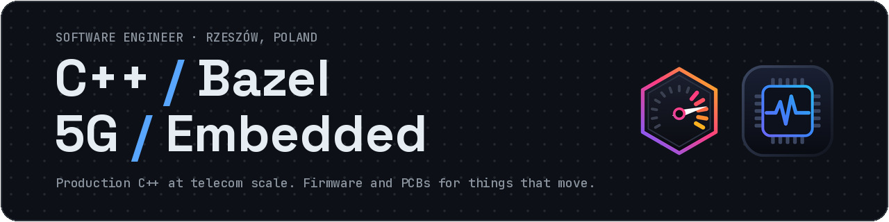
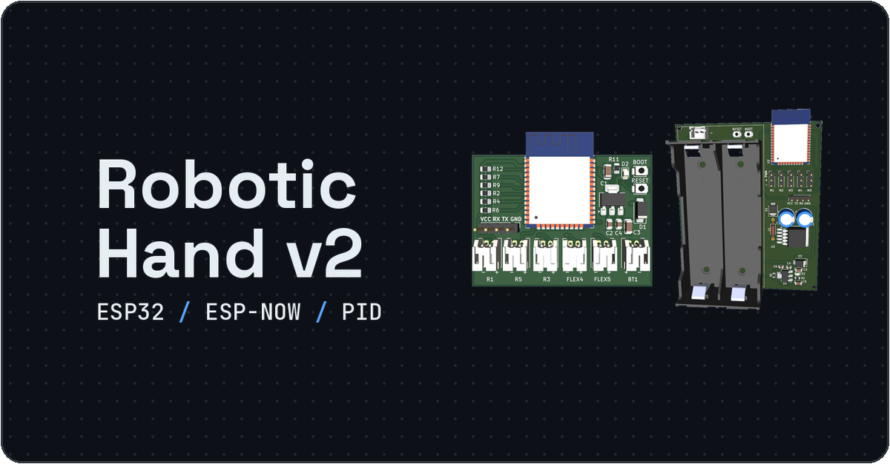
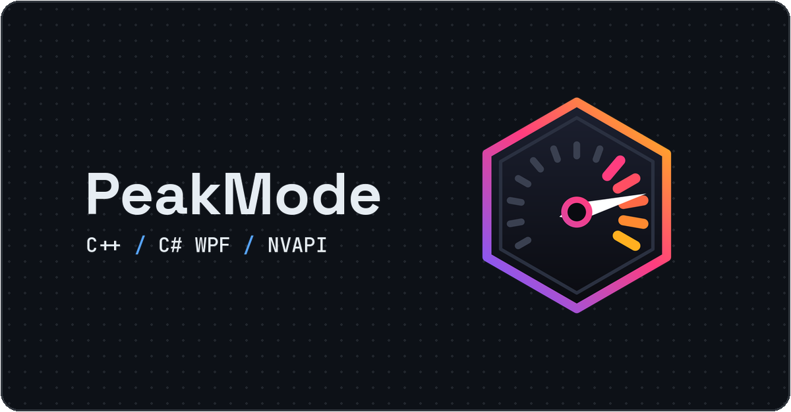
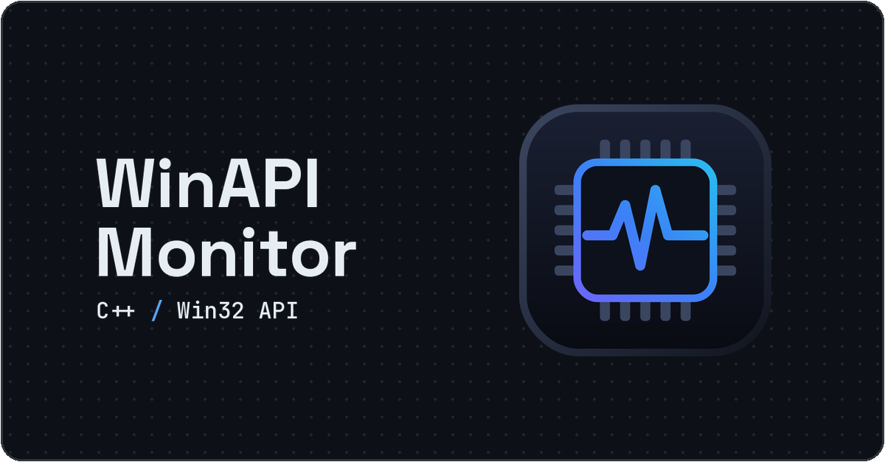
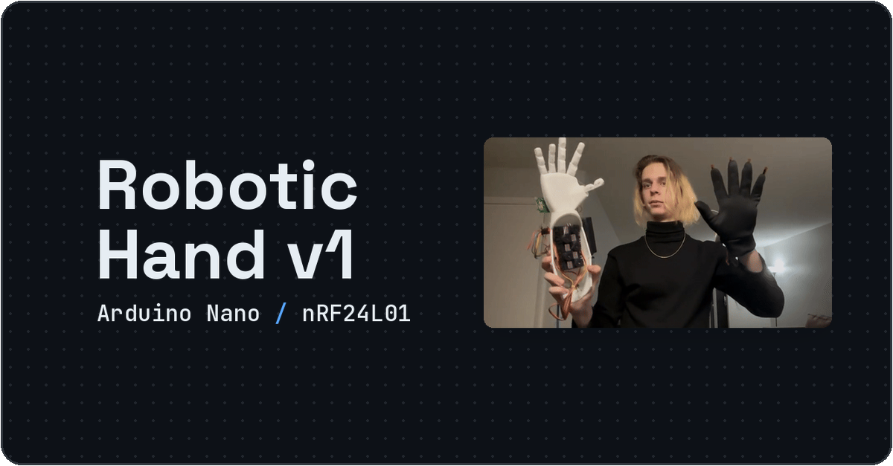
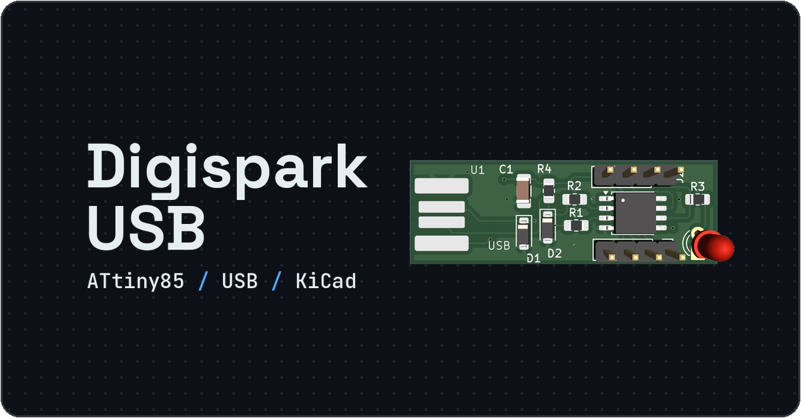
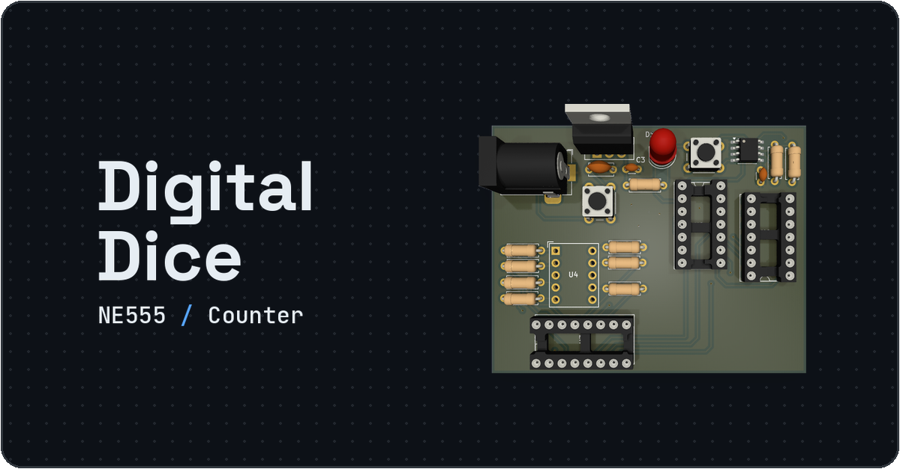

# Hi, I'm Vlad

C++ software engineer at Tietoevry, working on 5G Cloud RAN baseband software and, these days, build and test infrastructure with Bazel. Before that I designed embedded products end to end: schematic, PCB, firmware.

I started in competitive programming, and I still care most about code that is fast, correct and easy to reason about.

## Projects

&nbsp;&nbsp;

&nbsp;&nbsp;

&nbsp;&nbsp;

- **[Robotic Hand v2](https://github.com/SoloScriptSage/robotic-hand-esp32)**: Wireless prosthetic hand, my bachelor's thesis. ESP32, ESP-NOW, Kalman filter and PID per finger, two custom KiCad boards, web dashboard.
- **[PeakMode](https://github.com/SoloScriptSage/PeakMode)**: Windows gaming performance optimizer. Native C++ core with NVAPI and the Win32 API, C# WPF tray app, full restore on toggle-off.
- **[WinAPI System Monitor](https://github.com/SoloScriptSage/winapi-system-monitor)**: Real-time CPU, memory and process monitor in C++, built on direct Win32 calls with no frameworks.
- **[Robotic Hand v1](https://github.com/SoloScriptSage/robotic-hand-project)**: The first version: Arduino Nano, nRF24L01 radio link, five MG996R servos and a flex-sensor glove.
- **[Digispark-USB](https://github.com/SoloScriptSage/Digispark-USB)**: Custom ATtiny85 USB development board, designed in KiCad.
- **[Digital Dice](https://github.com/SoloScriptSage/Digital-Dice)**: 555 timer, counter and 7-segment decoder on a custom PCB.

## Stack

- **Languages:** C++17, C, Python, C#, Bash
- **Build and CI:** Bazel, CMake, Jenkins, Git, Gerrit, Docker, Linux
- **Telecom:** 5G NR, Layer 2, Cloud RAN
- **Embedded:** ESP32, STM32, Arduino, FreeRTOS, ESP-IDF, CAN, I2C, SPI, UART
- **Hardware:** KiCad, PCB design, soldering, oscilloscope and logic analyzer
- **Robotics:** ROS2, LiDAR-inertial SLAM, Kalman filtering, PID control

## Contact

[LinkedIn](https://www.linkedin.com/in/vladyslavhirchuk) · [hirchukv@gmail.com](mailto:hirchukv@gmail.com)
